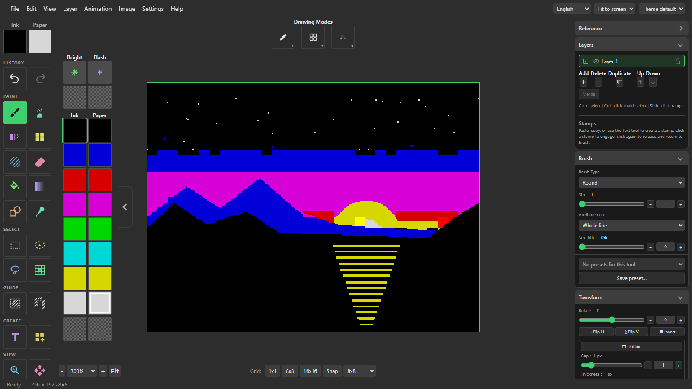
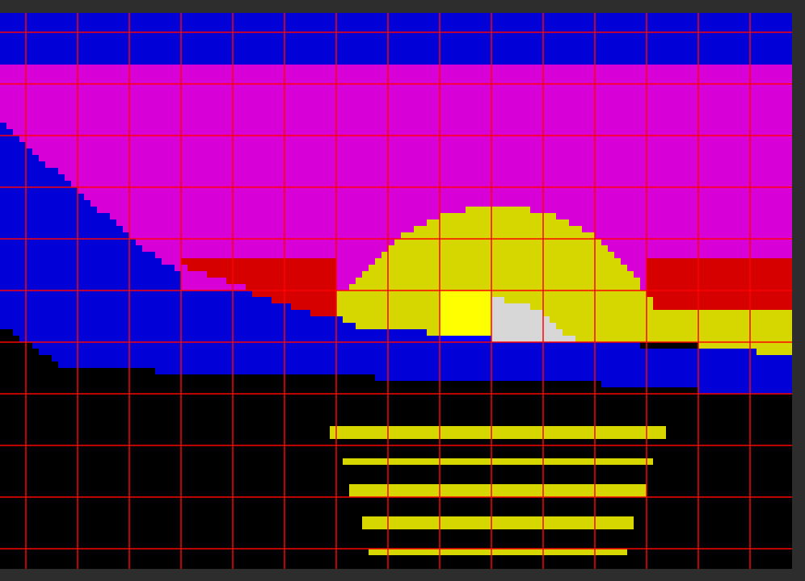
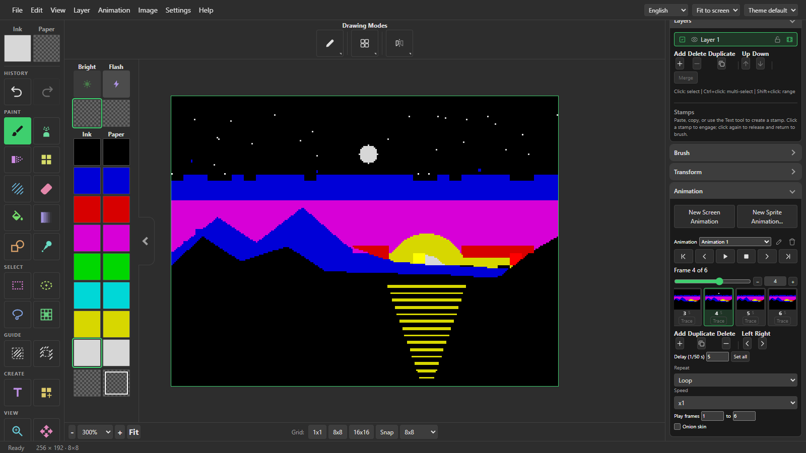
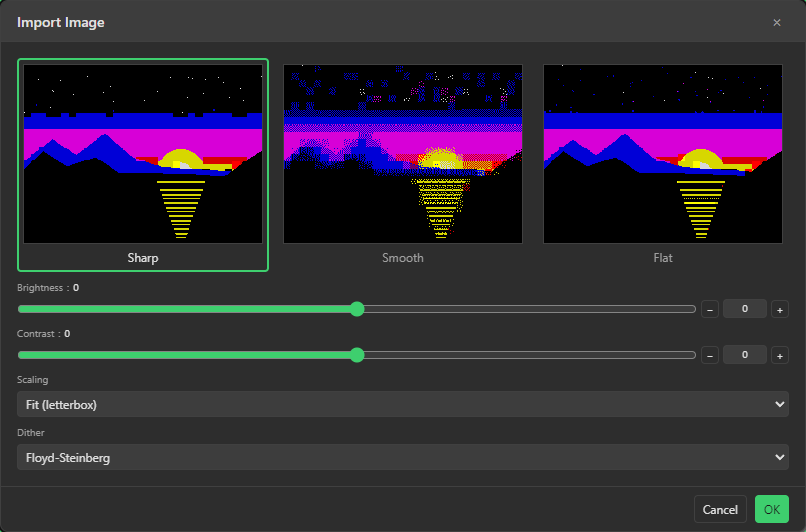

# PixULA

**A pixel art editor for ZX Spectrum graphics that runs in your browser.**

PixULA is a drawing program for making ZX Spectrum pictures: loading screens,
sprites, fonts, tile maps and short animations. It's named after the ULA, the
chip in the Spectrum that draws the screen and gives Spectrum graphics their
particular look.

It runs in a web browser, from a folder on your own computer, so there's
nothing to install and it works offline. It isn't trying to be Photoshop. It's
much closer to the old Spectrum art packages, and in particular to
**ZX Paintbrush** by Claus Jahn, which it borrows quite a lot from.

## Why the Spectrum is fussy about colour

A standard Spectrum screen is 256 x 192 pixels, but colour isn't stored per
pixel. It's stored per 8 x 8 block, and each block only gets two colours, an
ink and a paper, plus a Bright and a Flash setting. Draw a red line through a
block that already has blue in it and the blue turns red as well. That's
attribute clash, and working around it is a big part of the craft of Spectrum
art.

PixULA applies that rule while you draw rather than patching things up
afterwards, so what you see is pretty much what a real Spectrum would show. The
picture above is the sunset from the first screenshot, zoomed in with the cell
grid on. You can see where the edge of the sun has had to give way to the
colours of the cell it's sitting in.

## What it does

This is a rough tour. The manual inside the app goes into proper detail.

**Drawing.** There are around 20 tools: brush, spray, fade, pattern, hatch,
eraser, fill, gradient, shapes, Bezier curves, a figure tool for multi-point
shapes, an eyedropper, rectangle, ellipse and lasso selections, a cell grid
tool, text and a pattern creator. Seven drawing modes decide what a stroke does
to a cell. Besides normal drawing you can draw in XOR, change only the ink or
only the paper colour, or change a cell's colours and leave its pixels alone.
There's mirror drawing, snapping to the cell grid, and a custom grid for laying
things out.

**Screen modes.** There are eighteen, from the plain 48K screen to some fairly
obscure ones:

- Standard ULA, 256 x 192 with 8 x 8 colour cells
- Multicolour 8x4, 8x2 and 8x1
- ULAplus, ULAplus 8x1 (Timex) and ULANext
- Timex hi-res, 512 x 192
- GigaScreen, MultiGigaScreen 8x4, 8x2 and 8x1, and Timex hi-res GigaScreen
- ZX Spectrum Next: Layer 2 at 256 x 192, 320 x 256 and 640 x 256, LoRes
  128 x 96, and Radastan 128 x 96

Each mode has its own rules, and the tools follow whichever one you've picked.

**Layers and stamps.** You get layers with merging, flattening and the usual
moving about. Copy part of a picture and it becomes a stamp you can place as
often as you like. You can also put a reference photo behind your work to
trace over.

**Palettes.** In the modes that have a palette (ULAplus, ULANext and the Next
modes) you can edit it, keep a few versions to switch between, and load or save
it as `.pal` or `.npl`.

**Text, patterns and editors.** There's a text tool and a font editor for
Spectrum character sets. There are about a hundred built-in fill patterns
(dithers, halftones, hatching and textures), and you can make your own. A map
editor handles tile maps and a sprite editor handles Next sprites. Tape Blocks
opens a `.tap` or `.tzx`, shows what's in it, and lets you pull a screen out or
add your picture to the tape as a new block.

### Animation

You can animate the whole screen or just a sprite-sized block of it. Every
frame is still a proper Spectrum screen, so the colour rules carry on applying.
The Animation panel lets you step through the frames and set how long each one
stays up. Playback can loop, play once or go back and forth, and onion skinning
shows the frames either side faintly while you draw. A layer can be shared by
every frame, like a backdrop you only draw once, or have its own contents in
each frame.

When you're done, an animation can go out as numbered `.scr` files, an animated
GIF, a PNG sprite sheet, a multi-frame SevenuP file, a tape with one screen per
frame, or Next sprites.

### Bringing pictures in

Open a PNG, JPG or GIF and PixULA shows you three versions of it side by side:
Sharp, Smooth (dithered) and Flat. You pick whichever you like the look of.
There are brightness and contrast sliders, a choice of how the picture is
fitted to the screen, and about 30 dithering methods to try. It's a decent way
to get a photo into Spectrum colours as a starting point, though like any
conversion of this kind the result usually wants some tidying up by hand.

### File formats

PixULA opens around 40 kinds of file and saves to most of them. What you can
save depends on the screen mode you're in.

| | Formats |
|---|---|
| Spectrum screens | `.scr` `.zxp`, and it'll read `.bsc` files and the screen from a `.sna` snapshot |
| Multicolour, Timex and GigaScreen | `.mlt` `.ifl` `.hrg` `.img` `.mg1` `.mg2` `.mg4` `.mg8` |
| Spectrum Next | `.nxi` `.sl2` `.slr` `.ctile` `.spr` |
| Tape | `.tap` `.tzx` |
| Other Spectrum programs | `.zed` (ZX-Editor), `.sev` (SevenuP), `.zxm` (ZX-Paintbrush maps) |
| Fonts and maps | `.chr` `.ch4` `.ch6` `.ch8` `.chx` `.zxtm` |
| Palettes | `.pal` `.npl` |
| Everyday images | `.png` `.jpg` `.bmp` `.gif` |
| For programmers | `.asm` `.c` `.bin` `.atr` |

There's also `.pixula`, PixULA's own project file. It keeps everything:
layers, palette, animations, tool settings, the reference image, even where
you were zoomed in. Use it while a picture is in progress, and export to one of
the formats above when you want to hand it on.

### Bits and pieces

- Autosave into the browser, plus optional numbered backups into a folder you
  choose.
- The app and its manual come in 13 languages.
- There are eight colour themes.
- Graphics tablets work, and you can set what the pen's buttons and eraser end
  do. Touch screens work too.

## Getting it

**[Download a release](https://github.com/D0k-Soundwave/PixULA/releases)**,
unzip it anywhere, and double-click `PixULA.html`. That's the whole install.

Or try it straight away online:
[d0k-soundwave.github.io/PixULA](https://d0k-soundwave.github.io/PixULA/)

Either way it runs on your own machine. It doesn't need an internet connection,
and nothing you draw leaves your computer. Any reasonably recent browser should
do. Chrome and Edge get a couple of extras, such as saving files straight into
a folder, because they support the browser features those need.

If you'd rather run it from source, clone the repository and open `index.html`.
It's the same thing; the download is just that folder zipped up.

## The manual

It's built into the app, under **Help > Manual**. It covers every tool and its
options, all the screen modes and file formats, the pen and touch settings, and
some step-by-step workflows, with screenshots. It opens in whichever language
you've chosen and works offline like the rest of the app.

## Where it's at

PixULA is in **beta**. I use it, and it's been tested a fair bit, but there are
bound to be things I've missed, so feedback really does help.

A few things worth knowing:

- Some optional features ask the browser for permission the first time you use
  them, because they reach outside the page: choosing a backup folder, linking
  a reference photo from your disk, and pasting from the clipboard.
- Projects that contain an animation, saved with 0.1.0-beta.3 or later, won't
  open in 0.1.0-beta.2 or earlier. Projects without animations open in any
  version.

## Why I made it

I've always liked ZX Paintbrush, and I wondered whether I could make something
with a good chunk of its best features that would run on pretty much any
half-decent machine without installing anything. PixULA is that attempt. It's
written in plain HTML, CSS and JavaScript, with no libraries and no build step,
and it's a spare-time hobby project.

It's GPL 3.0 on purpose. A lot of Spectrum and pixel art tools are closed, and
nobody else can extend or fix them. I'd like this one to be the opposite: if
you think something's missing, add it. And if I ever stop working on it, I'd
hope someone else picks it up and carries on. That matters more to me than any
one feature.

## Maybe later

- SAM Coupe screen modes and file formats, at some point.

## Getting involved

- **Repository:** [github.com/D0k-Soundwave/PixULA](https://github.com/D0k-Soundwave/PixULA/)
- **Bugs and ideas:** open a [GitHub issue](https://github.com/D0k-Soundwave/PixULA/issues), or email [D0k@Soundwave.team](mailto:D0k@Soundwave.team)
- **Forks, fixes and add-ons** are very welcome. That's what the licence is for.

## Licence

PixULA is licensed under the **GNU General Public License v3.0**. See the
[LICENSE](LICENSE) file for the details.
